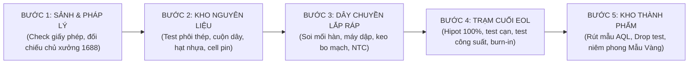
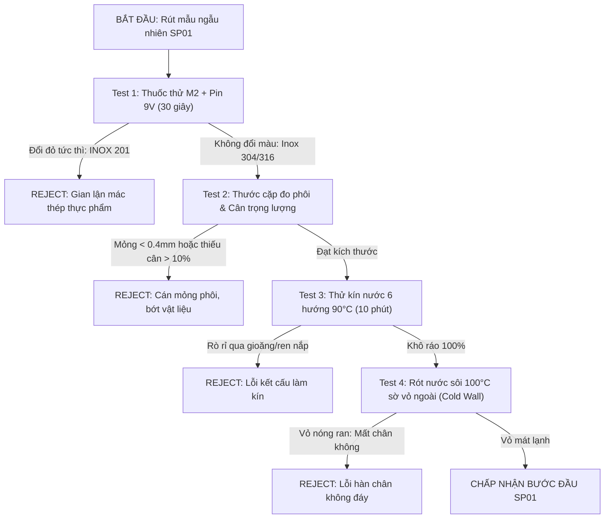
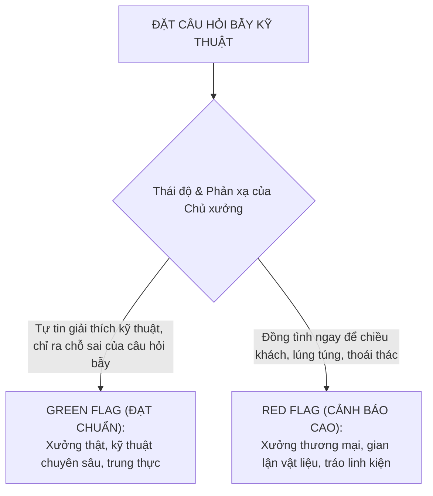

# SỔ TAY KIỂM TRA CHẤT LƯỢNG THỰC ĐỊA TẠI CHIẾT GIANG (3AE FIELD QC HANDBOOK)
## CẨM NANG THẨM ĐỊNH HIỆN TRƯỜNG & KIỂM CHÉO NHÀ MÁY GIA DỤNG THÔNG MINH 3AE

> **Chuyên trách**: Quality Verifier (@verifier)  
> **Căn cứ tích hợp**:  
> - Báo cáo Tiêu chí Kiểm định QC (@qc-criteria - `Plan/Bo_Tieu_Chi_Kiem_Dinh_Chat_Luong_QC_3AE.md`)  
> - Báo cáo Thẩm định Rủi ro Nhà cung cấp Chiết Giang (@supplier-audit - `Plan/Bao_Cao_Tham_Dinh_Rui_Ro_Chat_Luong_Nha_Cung_Cap_Chiet_Giang.md`)  
> **Phạm vi tác nghiệp**: Các cụm công nghiệp Chiết Giang (Vĩnh Khang, Vũ Nghĩa, Từ Khê, Dư Diêu, Nghĩa Ô, Ôn Châu)  
> **Mục tiêu**: Hướng dẫn thao tác nhanh 60 giây - 5 phút với vali dụng cụ bỏ túi, bóc trần gian lận vật liệu, kiểm soát nghiêm ngặt AQL 1.5/2.5.

---

## MỤC LỤC
1. [Nguyên Tắc Bất Di Bất Dịch & Quy Trình 5 Bước Thanh Tra Hiện Trường](#1-nguyen-tac-bat-di-bat-dich--quy-trinh-5-buoc-thanh-tra-hien-truong)
2. [Hành Trang Thực Chiến: Vali Dụng Cụ Field QC Toolkit Bỏ Túi](#2-hanh-trang-thuc-chien-vali-dung-cu-field-qc-toolkit-bo-tui)
3. [Bảng Ma Trận Kiểm Tra Chéo Kỹ Thuật & Cảnh Báo Rủi Ro 8 Nhà Cung Cấp](#3-bang-ma-tran-kiem-tra-cheo-ky-thuat--canh-bao-rui-ro-8-nha-cung-cap)
4. [SOP Kiểm Tra Nhanh Từng Dòng Sản Phẩm (On-site Rapid Test Procedures)](#4-sop-kiem-tra-nhanh-tung-dong-san-pham-on-site-rapid-test-procedures)
   - [SP01: Bình giữ nhiệt Inox chân không](#sp01-binh-giu-nhiet-inox-chan-khong)
   - [SP02: Nồi chiên không dầu điện tử / cơ](#sp02-noi-chien-khong-dau-dien-tu--co)
   - [SP03: Máy hút bụi không dây cầm tay BLDC](#sp03-may-hut-bui-khong-day-cam-tay-bldc)
   - [SP04: Đèn ngủ cảm biến hồng ngoại PIR sạc USB](#sp04-den-ngu-cam-bien-hong-ngoai-pir-sac-usb)
   - [SP05 & SP06: Nồi lẩu điện mini & Ca nấu mì đa năng](#sp05--sp06-noi-lau-dien-mini--ca-nau-mi-da-nang)
   - [SP08: Quạt kẹp mini Gimbal sạc USB](#sp08-quat-kep-mini-gimbal-sac-usb)
   - [Phụ kiện: Dây nguồn AC & Cân điện tử thông minh](#phu-kien-day-nguon-ac--can-dien-tu-thong-minh)
5. [Cẩm Nang 10 Câu Hỏi Bẫy Kỹ Thuật & Tâm Lý Học Hiện Trường](#5-cam-nang-10-cau-hoi-bay-ky-thuat--tam-ly-hoc-hien-truong)
6. [Quy Chuẩn Lấy Mẫu AQL Thực Chiến, Xử Lý Sự Cố (NCR) & Niêm Phong Mẫu Vàng](#6-quy-chuan-lay-mau-aql-thuc-chien-xu-ly-su-co-ncr--niem-phong-mau-vang)

---

## 1. NGUYÊN TẮC BẤT DI BẤT DỊCH & QUY TRÌNH 5 BƯỚC THANH TRA HIỆN TRƯỜNG

### A. Tôn Chỉ Thẩm Định Hiện Trường 3AE
1. **"Trust but Verify" (Không nghe xưởng hứa, chỉ tin số đo)**: 
   Mọi lời cam kết của chủ xưởng, bằng chứng nhận lộng kính treo ở sảnh, hay mẫu bày trong phòng họp (Showroom Sample) đều là "hàng tuyển". Chất lượng thật của đơn hàng chỉ nằm ở **cuộn phôi nguyên liệu đầu vào, linh kiện đang nằm trên chuyền dập/ép, và thùng hàng ngẫu nhiên trong kho**.
2. **Quyền năng độc lập của QC Verifier**:
   Thanh tra viên 3AE có quyền tự tay rút mẫu ngẫu nhiên tại bất kỳ công đoạn nào, yêu cầu bóc tách vỏ kiểm tra bo mạch, và dừng nghiệm thu nếu phát hiện bất kỳ dấu hiệu gian dối vật liệu nào.
3. **Nguyên tắc "Zero Tolerance" (Không khoan nhượng)**:
   Phát hiện 01 lỗi an toàn điện rò rỉ, 01 trường hợp tráo Inox 201 vào ruột tiếp xúc thực phẩm, hoặc 01 vụ việc dùng cell pin phế liệu -> **BÁC BỎ TOÀN BỘ LÔ HÀNG (REJECT 100%) NGAY TẠI CHỖ**.

---

### B. Quy Trình 5 Bước Thanh Tra Hiện Trường (The 5-Step On-site Audit)



* **Bước 1: Kiểm tra Pháp nhân & Năng lực thật**: 
  Đối chiếu tên pháp nhân trên giấy phép kinh doanh với tài khoản nhận tiền và hồ sơ Siêu nhà máy 1688 (loại trừ các công ty thương mại trung gian thuê xưởng).
* **Bước 2: Đột kích Kho nguyên liệu thô (Raw Material Warehouse)**: 
  Không vội vào phòng họp. Đi thẳng vào khu vực tập kết cuộn thép, thùng đựng hạt nhựa, khay đựng cell pin và dây nguồn để thử nghiệm tại gốc.
* **Bước 3: Giám sát Trực tiếp Dây chuyền Lắp ráp (Assembly Line Walk)**: 
  Quan sát kỹ thao tác công nhân: Mối nối dây điện có bọc co nhiệt không? Mạch MCU có được phủ keo chống ẩm không? Công đoạn bấm cos dây có chắc chắn không?
* **Bước 4: Kiểm tra Trạm Đo Cuối Chuyền (End-of-Line - EOL Station)**: 
  Xem thông số cài đặt thực tế của máy đo điện áp cao Hi-pot (điện áp và dòng rò cắt) và trạm chạy rà lão hóa (Burn-in test).
* **Bước 5: Rút mẫu AQL Kho Thành phẩm & Niêm phong Mẫu Vàng (Golden Sample)**: 
  Tự tay bốc mẫu từ các góc thùng khác nhau, thực hiện các bài test chức năng, lập biên bản nghiệm thu hoặc biên bản sự cố (NCR).

---

## 2. HÀNH TRANG THỰC CHIẾN: VALI DỤNG CỤ FIELD QC TOOLKIT BỎ TÚI

Toàn bộ dụng cụ phục vụ thanh tra phải nằm gọn trong 01 vali xách tay 20 inch, sẵn sàng tác nghiệp độc lập tại xưởng mà không cần mượn thiết bị của đối tác:

| STT | Dụng cụ kiểm tra | Thông số kỹ thuật khuyên dùng | Chức năng bóc trần gian lận | Ứng dụng chính |
| :---: | :--- | :--- | :--- | :--- |
| **1** | **Bộ hóa chất thử Inox (M2 Liquid) + Pin 9V** | Lọ thuốc thử quang hóa Mangan/Niken + Kẹp cực 9V | Nhỏ giọt phát hiện Inox 201 giả 304/316 trong 30 giây | SP01, SP05, SP06 |
| **2** | **Thước cặp điện tử kỹ thuật số** | Dải đo 0-150mm, độ chính xác $0.01mm$ | Đo độ dày phôi inox, nan lồng quạt, tiết diện lõi đồng | Tất cả sản phẩm |
| **3** | **Cân tiểu ly điện tử bỏ túi** | Dải đo 0.1g - 3.000g, đĩa cân inox | Cân cell pin, cân ruột bình inox, cân phôi nhựa | SP01, SP03, SP04, SP08 |
| **4** | **Đồng hồ vạn năng số (Digital Multimeter)** | True-RMS (Fluke 107 / Uni-T UT33D+ / Kyoritsu) | Đo thông mạch tiếp địa, điện trở cuộn dây, sụt áp sạc | Tất cả SP điện gia dụng |
| **5** | **Đồng hồ đo công suất cắm ổ (Wattmeter)** | 220V - 16A, màn hình LCD hiển thị W, V, A, PF | Đo công suất thực tế, phát hiện ăn bớt thanh nhiệt | SP02, SP05, SP06 |
| **6** | **Nhiệt kế hồng ngoại & Que đo đầu nhọn** | Bắn nhiệt hồng ngoại (-50°C đến 500°C) + Que dò | Đo nhiệt độ buồng nướng, nước sôi, thanh mayso | SP01, SP02, SP05, SP06 |
| **7** | **Đèn pin cực tím tia UV bước sóng 365nm** | LED UV công suất cao, kính lọc đen Wood | Soi lớp keo chống ẩm Conformal Coating bo mạch | SP02, SP03, SP04, SP05 |
| **8** | **Dao cắt Cross-hatch + Băng dính 3M 600** | Dao rọc sắc bén + Thước cữ 1mm + Cuộn 3M 600 | Test độ bám dính lớp men chống dính Teflon/Ceramic | SP02, SP05, SP06 |
| **9** | **Nam châm đất hiếm Neodymium N52** | Lực hút mạnh đường kính 20mm | Test sơ bộ từ tính kim loại, kiểm tra đế hút đèn | SP01, SP04, SP05, SP08 |
| **10**| **Kìm tuốt/cắt dây & Bút thử điện cảm ứng** | Kìm đa năng đo cỡ dây AWG + Bút thử điện áp AC | Cắt kiểm tra lõi dây nguồn đồng vs CCA, rò điện vỏ | Toàn bộ thiết bị 220V |
| **11**| **Bút lông dầu không xóa + Tem niêm phong 3AE** | Bút Sharpie đen/đỏ + Tem giáp lai vỡ (Void sticker) | Ký niêm phong Mẫu Vàng (Golden Sample) tại chỗ | Kết thúc buổi làm việc |

---

## 3. BẢNG MA TRẬN KIỂM TRA CHÉO KỸ THUẬT & CẢNH BÁO RỦI RO 8 NHÀ CUNG CẤP

Kiểm tra chéo giữa tiêu chuẩn của @qc-criteria và hồ sơ rủi ro của @supplier-audit để xác định trọng tâm kiểm tra tại từng xưởng:

| STT | Nhà Cung Cấp Mục Tiêu | Địa Bàn | Sản Phẩm Mục Tiêu | Điểm Trọng Yếu Cần Soi Kỹ (Target Audit Points) | Mức Rủi Ro & RPN | Bài Test Thực Địa Bắt Buộc |
| :---: | :--- | :--- | :--- | :--- | :---: | :--- |
| **1** | **Zhejiang Weijiang** (伟匠) | Vũ Nghĩa / Vĩnh Khang | SP01 (Bình giữ nhiệt), SP02 (Nồi chiên) | Tráo Inox 201 vào ruột đáy bình; mối hàn đáy rỗ khí mất chân không; lớp sơn chống dính mỏng. | **TRUNG BÌNH**<br>(RPN: 168) | - Nhỏ thuốc thử M2 + pin 9V vào ruột đáy bình.<br>- Test nước sôi $100^\circ C$ đo vỏ ngoài sau 15 phút.<br>- Rạch lưới Cross-hatch khay chiên dán băng keo 3M. |
| **2** | **Ningbo Shimono** (下野) | Từ Khê, Ninh Ba | SP03 (Máy hút bụi không dây) | Dùng motor chổi than ép xung đội lốt BLDC; cell pin loại B không NTC; màng HEPA giả giấy thường. | **TRUNG BÌNH - THẤP**<br>(RPN: 120) | - Nhìn khe gió tìm tia lửa điện chổi than khi bấm cò.<br>- Cân cell pin 18650 đối chiếu $\ge 44g$, soi mã QR EVE.<br>- Tháo HEPA rọi đèn pin kiểm tra gioăng mút kín khí. |
| **3** | **Yuyao/Cixi Haidebao** (海德宝) | Dư Diêu / Từ Khê | SP05, SP06 (Ca lẩu/nấu mì), Dây nguồn | Ruột dây nguồn thiếu tiết diện ($<0.5mm^2$) hoặc dùng nhôm mạ đồng CCA; rơ-le cạn nước dính tiếp điểm. | **CAO**<br>(RPN: 240) | - Bấm cắt đôi sợi dây nguồn đo lõi đồng, cạo men thử màu.<br>- Test đun cạn nước 20ml đo thời gian nhảy ngắt $\le 90s$.<br>- Đo thông mạch dây tiếp địa $R \le 0.1 \Omega$. |
| **4** | **Zhejiang Haoda** (豪达) | Thiệu Hưng / Vũ Nghĩa | SP02 (Nồi chiên không dầu) | Mùi khét nhựa do bỏ qua khâu nướng sấy degassing; sai số cảm biến nhiệt NTC; mayso Inox 201. | **THẤP - TRUNG BÌNH**<br>(RPN: 135) | - Chạy thử nồi $200^\circ C$ trong 15 phút ngửi khói buồng nướng.<br>- Đo nhiệt độ thực buồng chiên đối chiếu sai số $\le \pm 10^\circ C$.<br>- Đo công suất thực bằng đồng hồ Wattmeter. |
| **5** | **Ningbo Eytronic** (艾创) | Từ Khê, Ninh Ba | SP02 (Nồi chiên cảm ứng) | Mạch MCU màn hình cảm ứng thiếu keo chống ẩm Conformal Coating gây loạn phím; sơn khay 1 lớp. | **TRUNG BÌNH**<br>(RPN: 180) | - Chiếu đèn UV 365nm lên bo mạch MCU kiểm tra phát quang keo.<br>- Test kéo giỏ chiên ngắt vi động lập tức.<br>- Cắt lưới Cross-hatch khay hứng mỡ. |
| **6** | **Ningbo Jewin** (久银) | Từ Khê, Ninh Ba | SP02 (Nồi chiên lớn), SP05, SP06 | Lòng nồi Inox cán mỏng ($<0.35mm$) phồng đáy khi nóng; kính cửa sổ nồi chiên chưa qua Heat Soak Test. | **TRUNG BÌNH**<br>(RPN: 150) | - Thước cặp điện tử đo chiều dày thành và đáy Inox $\ge 0.50mm$.<br>- Test sốc nhiệt kính: Nướng $200^\circ C$ mở cửa xịt nước sương.<br>- Soi gioăng silicone nắp đậy chịu nhiệt. |
| **7** | **Zhejiang Sokany** (苏肯尼) | Nghĩa Ô / Kim Hoa | SP06 (Ca mì), SP08 (Quạt kẹp) | Stator quấn dây nhôm mạ đồng CCA; nhựa tái sinh $>40\%$ giòn gãy; bỏ qua khâu test rò điện Hipot. | **RẤT CAO**<br>(RPN: 320) | - Cạo men dây stator động cơ quạt kiểm tra lõi nhôm.<br>- Bẻ thử ngàm nhựa và đo ba-via sắc nhọn.<br>- Bắt buộc cắm máy kiểm tra cao áp Hi-pot $1.500V$. |
| **8** | **Guangdong Camry / Senssun** | Vĩnh Khang / Trung Sơn | Cân điện tử thông minh | Thanh nhôm Load-cell hợp kim tạp chất gây trôi số zero drift; kính vỡ do niken sulfide; dòng tĩnh cao. | **THẤP**<br>(RPN: 96) | - Test lặp lại tải trọng 5 lần ở 4 góc cân sai số $\le 100g$.<br>- Đo dòng chờ Bluetooth Multimeter $\le 25 \mu A$.<br>- Yêu cầu biên bản Heat Soak Test kính cường lực. |

---

## 4. SOP KIỂM TRA NHANH TỪNG DÒNG SẢN PHẨM (ON-SITE RAPID TEST PROCEDURES)

---

### SP01: BÌNH GIỮ NHIỆT INOX CHÂN KHÔNG

#### Quy trình 5 bài test thực chiến:



#### Chi tiết thao tác:
1. **Bài Test 1: Thử Thuốc Thử M2 + Pin 9V Bóc Trần Inox 201 (Thời gian: 30 giây)**:
   - *Dụng cụ*: Lọ hóa chất M2 + Pin vuông 9V có 2 dây kẹp cá sấu.
   - *Thao tác*: Dùng giấy nhám mịn cạo nhẹ lớp dầu bóng ở lòng đáy bình. Nhỏ 1 giọt dung dịch M2. Kẹp cực âm (-) vào vành miệng bình, chấm nhẹ cực dương (+) vào giọt dung dịch trong 3-5 giây.
   - *Tiêu chuẩn Đạt*: Giọt dung dịch giữ nguyên màu trong suốt hoặc hơi ngả xám nhạt sau 45-60 giây (SUS 304/316).
   - *Dấu hiệu Gian lận*: Giọt thuốc thử **đổi sang màu đỏ sẫm hoặc hồng cánh sen chỉ sau 1-3 giây** -> Kết luận: Xưởng dùng thép 201 nhiều Mangan. **LẬP TỨC REJECT TOÀN BỘ LÔ HÀNG**.
2. **Bài Test 2: Thước Cặp & Cân Tiểu Ly Kiểm Soát Ăn Bớt Độ Dày Phôi (Thời gian: 1 phút)**:
   - *Thao tác*: Đo chiều dày miệng thành bình bằng thước cặp kỹ thuật số (chuẩn: $0.50mm \pm 0.05mm$). Cân trọng lượng thân bình không nắp trên cân tiểu ly.
   - *Tiêu chuẩn Đạt*: Trọng lượng thân bình 500ml đạt từ $210g - 235g$ (tùy thiết kế). Nếu nhẹ dưới $185g$, xưởng đã dùng phôi dập cán mỏng $0.30mm$ cực kỳ dễ móp méo khi va chạm nhẹ.
3. **Bài Test 3: Thử Nghiệm Kín Nước Động & Tĩnh 6 Hướng (Thời gian: 10 phút)**:
   - *Thao tác*: Rót nước nóng $90^\circ C$ vào 90% dung tích bình. Vặn chặt nắp. Lắc mạnh theo phương thẳng đứng 30 lần. Đặt nằm ngang trên khăn giấy khô 5 phút, sau đó lật úp đầu nắp xuống 5 phút tiếp theo.
   - *Tiêu chuẩn Đạt*: Giấy ăn khô ráo 100%, không xuất hiện giọt ẩm ở khe ren nắp hoặc nút bấm mở uống.
4. **Bài Test 4: Sờ Thân Bình Nhanh (Cold Wall Quick Test - Thời gian: 5 phút)**:
   - *Thao tác*: Rót nước sôi $100^\circ C$ đầy bình, đậy kín nắp, chờ 3 phút. Dùng lòng bàn tay ôm chặt toàn bộ thân bình và đáy bình.
   - *Tiêu chuẩn Đạt*: Vỏ bình hoàn toàn mát lạnh (hoặc chỉ hơi ấm nhẹ ở phần cổ ren tiếp giáp nắp nhựa).
   - *Dấu hiệu Lỗi*: Thân bình hoặc đáy bình nóng ran đến mức không thể áp tay -> Đã mất chân không lớp vỏ. Tỷ lệ lỗi cho phép: $0\%$.
5. **Bài Test 5: Khứu Giác Kiểm Tra Mùi Nắp Silicone & Nhựa PP (Thời gian: 1 phút)**:
   - Mở nắp bình mới khui thùng, ngửi sát gioăng silicone. Silicone thực phẩm đạt chuẩn LFGB/FDA phải không có mùi hôi hắc hóa chất hoặc mùi dầu lưu hóa cao su.

---

### SP02: NỒI CHIÊN KHÔNG DẦU ĐIỆN TỬ / CƠ

#### Quy trình 5 bài test thực chiến:
1. **Bài Test 1: Đo Công Suất Thực & Hệ Số PF Bằng Wattmeter (Thời gian: 3 phút)**:
   - *Dụng cụ*: Đồng hồ công suất cắm ổ (Digital Wattmeter).
   - *Thao tác*: Cắm nồi chiên qua Wattmeter, vặn nhiệt độ tối đa $200^\circ C$. Đọc chỉ số công suất $P_{thực}$ và điện áp lưới $U$.
   - *Tiêu chuẩn Đạt*: Dung sai công suất theo IEC 60335: $-10\% \le \Delta P \le +5\%$. (Ví dụ: Nồi dán nhãn 1500W thì công suất hiển thị phải đạt từ $1.350W$ đến $1.575W$).
   - *Dấu hiệu Gian lận*: Nồi ghi nhãn 1800W nhưng đo thực tế chỉ đạt $1300W - 1400W$ (xưởng dùng sợi đốt mayso nhỏ để giảm giá thành linh kiện).
2. **Bài Test 2: Cắt Lưới Thử Độ Bám Men Chống Dính (Cross-Hatch Tape Test - Thời gian: 3 phút)**:
   - *Dụng cụ*: Dao rọc giấy lưỡi sắc, thước cữ kẻ vạch 1mm, băng dính chuyên dụng 3M 600.
   - *Thao tác*: Dùng dao rạch 6 đường ngang và 6 đường dọc vuông góc sâu xuyên qua lớp sơn chạm kim loại (tạo lưới 25 ô vuông). Dán băng dính 3M lên lưới, miết chặt bằng đầu ngón tay trong 60 giây, giật dứt khoát một góc $90^\circ$.
   - *Tiêu chuẩn Đạt*: Đạt Class 0 / Class 1 (ISO 2409) - không có bất kỳ mảng sơn nào bị bong tróc theo băng dính, các mép cắt nhẵn thín.
   - *Dấu hiệu Lỗi*: Sơn tróc từng mảng lớn lộ tôn thép -> Lớp sơn sấy non nhiệt hoặc không qua xử lý hóa chất bề mặt (Phosphate hóa).
3. **Bài Test 3: Soi Đèn UV 365nm Phát Hiện Mạch MCU Không Phủ Keo Chống Ẩm (Thời gian: 2 phút)**:
   - *Dụng cụ*: Đèn pin UV bước sóng 365nm + tua vít mở nắp sau bảng điều khiển.
   - *Thao tác*: Rọi chùm tia UV vào bo mạch vi điều khiển (MCU) mặt trước.
   - *Tiêu chuẩn Đạt*: Toàn bộ bề mặt chân linh kiện dán SMT và vi xử lý phải phát quang ánh sáng vàng chanh hoặc xanh lục đặc trưng của lớp keo silicon/acrylic chống ẩm (Conformal coating IP54).
   - *Dấu hiệu Nguy Hiểm*: Bo mạch tối sẫm, không có ánh phát quang keo -> Nguy cơ chập cháy, loạn phím cảm ứng sau 2 tháng dùng trong môi trường hơi dầu mỡ.
4. **Bài Test 4: Chạy Đốt Nóng 200°C 15 Phút Kiểm Tra Mùi Khét Nhựa (Degassing Burn-in Test)**:
   - *Thao tác*: Cho nồi chiên hoạt động ở $200^\circ C$ trong phòng kín gió.
   - *Tiêu chuẩn Đạt*: Chỉ có làn khói mờ bốc lên trong 3 phút đầu do bay hơi dầu bảo quản thanh nhiệt mới. Sau 7 phút, không khí tỏa ra từ cửa thoát gió hoàn toàn không có mùi khét lẹt của nhựa tái sinh hay mùi nồng nặc của keo dán công nghiệp.
5. **Bài Test 5: Kiểm Tra Công Tắc Vi Động Ngắt Điện An Toàn (Micro-Switch Safety Cut-off)**:
   - *Thao tác*: Khi nồi đang chạy đỏ thanh nhiệt ở $200^\circ C$, kéo giỏ chiên ra ngoài 5cm.
   - *Tiêu chuẩn Đạt*: Nồi phải lập tức ngắt điện sợi đốt và dừng quạt gió trong vòng $0.5$ giây. Màn hình chuyển về trạng thái chờ (Pause/Standby). Đẩy giỏ vào lại, nồi phải tự động chạy tiếp chương trình.

---

### SP03: MÁY HÚT BỤI KHÔNG DÂY CẦM TAY BLDC

#### Quy trình 5 bài test thực chiến:
1. **Bài Test 1: Bóc Mẽ Động Cơ Chổi Than Đội Lốt Brushless BLDC (Thời gian: 10 giây)**:
   - *Thao tác*: Đưa máy vào vùng khuất sáng hoặc nhìn qua khe tản nhiệt phía sau khoang động cơ. Bấm cò khởi động và nhả cò liên tục 3 lần.
   - *Dấu hiệu BLDC xịn (ĐẠT)*: Động cơ tăng tốc cực êm lên tần số cao (tiếng rít phản lực), hãm điện tử dừng tức thì khi nhả cò, **HOÀN TOÀN KHÔNG CÓ TIA LỬA ĐIỆN**.
   - *Dấu hiệu Chổi than lừa đảo (REJECT)*: Nhìn thấy **tia lửa điện màu cam/xanh xẹt sáng rực** ở cổ góp khi đề pa và nhả cò; có tiếng cọ xát ma sát cơ học; thân máy ấm lên rất nhanh sau 1 phút chạy.
2. **Bài Test 2: Đo Lực Hút Chân Không Bằng Phương Pháp Bịt Đầu Nâng Tải (Thời gian: 1 phút)**:
   - *Dụng cụ*: Chai nước suối 1.5 lít (nặng 1.5kg) hoặc quả tạ kim loại 2.0kg có bề mặt phẳng nhẵn.
   - *Thao tác*: Bật máy ở chế độ Turbo/Max. Đưa miệng đầu hút áp sát vào bề mặt chai nước/vật nặng, nhấc bổng thẳng đứng lên không trung.
   - *Tiêu chuẩn Đạt*: Lực hút chân không đạt $\ge 15 kPa$ sẽ hút chặt và nhấc bổng chai nước 1.5kg lơ lửng trong 10 giây mà không bị tuột rơi.
3. **Bài Test 3: Cân Trọng Lượng & Soi Mã Laser Cell Pin 18650 (Thời gian: 3 phút)**:
   - *Dụng cụ*: Cân tiểu ly điện tử + dao cạy nắp khoang pin.
   - *Thao tác*: Mở 1 pack pin ngẫu nhiên, đưa cell pin 18650 lên cân tiểu ly.
   - *Tiêu chuẩn Đạt*: 
     + Trọng lượng mỗi cell pin dung lượng 2.000mAh - 2.500mAh phải đạt chuẩn từ **$44.0g$ đến $48.5g$**. (Nếu cell pin nhẹ dưới $38g$, chắc chắn là cell phế liệu hoặc cell giả dung lượng).
     + Trên thân cell khắc laser mã ma trận QR sắc nét của các hãng lớn: **EVE, BAK, Lishen, Sunpower**. Quét mã QR phải hiển thị thông tin ngày sản xuất trong vòng 6 tháng gần nhất.
4. **Bài Test 4: Soi Cảm Biến Nhiệt NTC Trên Khối Pack Pin (Thời gian: 1 phút)**:
   - *Thao tác*: Quan sát bo mạch bảo vệ pin (BMS).
   - *Tiêu chuẩn Đạt*: Bắt buộc phải có 01 đầu cảm biến nhiệt bán dẫn NTC (bọc keo cách điện màu đen/trắng) áp sát trực tiếp vào thân các cell pin. Nếu BMS chỉ có linh kiện trần không có dây cảm biến nhiệt dẫn vào thân cell -> **REJECT vì nguy cơ cháy nổ khi sạc pin qua đêm**.
5. **Bài Test 5: Kiểm Tra Gioăng Làm Kín Màng HEPA Chống Bụi Mịn Đi Tắt (Air Bypass Test)**:
   - *Thao tác*: Tháo màng lọc HEPA, dùng ngón tay ấn vào viền gioăng cao su bọt biển. Lắp lại vào hộp bụi và soi đèn pin từ trong ra ngoài.
   - *Tiêu chuẩn Đạt*: Gioăng xốp đàn hồi tốt, viền màng ép chặt khít 100%, không lọt bất kỳ tia sáng nào qua khe vành tiếp giáp.

---

### SP04: ĐÈN NGỦ CẢM BIẾN HỒNG NGOẠI PIR SẠC USB

#### Quy trình 5 bài test thực chiến:
1. **Bài Test 1: Kiểm Tra Góc Quét 120° & Khoảng Cách Nhận Diện PIR (Thời gian: 2 phút)**:
   - *Thao tác*: Đặt đèn ở độ cao 1.0m - 1.2m trong phòng tối. Di chuyển bước chân từ khoảng cách 4.0m cắt ngang vuông góc với hướng mắt đèn.
   - *Tiêu chuẩn Đạt*: Đèn nhận diện chuyển động và bật sáng ngay lập tức ở khoảng cách $\ge 3.0m - 4.0m$. Góc quét mở rộng hai bên đạt tối thiểu $110^\circ - 120^\circ$. Thời gian trễ duy trì sáng trước khi tự tắt ổn định trong dải $15s - 25s$.
2. **Bài Test 2: Khóa Cảm Biến Ban Ngày (Daylight Inhibit Test - Thời gian: 30 giây)**:
   - *Thao tác*: Để đèn dưới ánh sáng phòng thông thường ($>30 lux$). Vẫy tay liên tục cách mắt cảm biến 30cm.
   - *Tiêu chuẩn Đạt*: Đèn **TUYỆT ĐỐI KHÔNG BẬT SÁNG** (cảm biến quang điện đã khóa PIR để tiết kiệm pin). Khi dùng tay che kín mắt cảm biến tạo bóng tối rồi vẫy tay, đèn phải bật sáng tức thì.
3. **Bài Test 3: Đo IC Bảo Vệ Sạc/Xả Pin Lithium Polymer (PCM Audit - Thời gian: 2 phút)**:
   - *Dụng cụ*: Đồng hồ vạn năng hoặc kính lúp soi bo mạch.
   - *Thao tác*: Mở vỏ 01 đèn ngẫu nhiên, soi cụm linh kiện nối giữa pin và cổng sạc Type-C.
   - *Tiêu chuẩn Đạt*: Bắt buộc có IC bảo vệ chuyên dụng mã **DW01A (hoặc tương đương) kết hợp MOSFET kép 8205A** (con chip 6 chân và 8 chân dán cạnh pin).
   - *Dấu hiệu Nguy Hiểm*: Dây pin hàn trực tiếp vào chân cổng sạc Type-C chỉ qua 1 con đi-ốt chống ngược -> **REJECT NGAY LẬP TỨC** do nguy cơ phồng nổ pin khi cắm sạc củ sạc nhanh.
4. **Bài Test 4: Cân Trọng Lượng Pin Polymer Bóc Mẽ Dung Lượng Ảo (Thời gian: 1 phút)**:
   - *Dụng cụ*: Cân tiểu ly điện tử $0.1g$.
   - *Tiêu chuẩn Đạt*: Pin pouch cell Li-Po dung lượng danh định 500mAh phải nặng từ **$9.5g - 11.5g$**; pin 1000mAh phải nặng từ **$19g - 22g$**. Nếu xưởng in 800mAh nhưng cân chỉ được $6g$, thực chất là cell 250mAh phế thải.
5. **Bài Test 5: Lực Hút Nam Châm & Keo Xốp 3M VHB (Thời gian: 1 phút)**:
   - *Thao tác*: Dán miếng sắt lên tường gạch/gỗ, đặt đèn hút vào miếng sắt. Dùng tay lắc mạnh thân đèn theo phương ngang.
   - *Tiêu chuẩn Đạt*: Nam châm Neodymium giữ chặt đèn, không xê dịch góc nghiêng. Bóc lớp bảo vệ keo xốp không bị rách mủn, màng keo dính chặt không bong tróc.

---

### SP05 & SP06: NỒI LẨU ĐIỆN MINI & CA NẤU MÌ ĐA NĂNG

#### Quy trình 5 bài test thực chiến:
1. **Bài Test 1: Bấm Cắt Dây Nguồn AC Đo Lõi Đồng & Soi CCA (Thời gian: 2 phút)**:
   - *Dụng cụ*: Kìm cắt dây + Thước cặp điện tử kỹ thuật số.
   - *Thao tác*: Cắt ngang 01 sợi dây nguồn đi kèm máy. Tuốt lớp vỏ cao su bọc ngoài. Đếm số sợi đồng trong mỗi lõi và đo đường kính sợi.
   - *Tiêu chuẩn Đạt*: 
     + Dây nguồn chuẩn $3 \times 0.75mm^2$ phải có 24 sợi đồng đường kính $\ge 0.20mm$ mỗi sợi (hoặc tiết diện tổng $\ge 0.72mm^2$).
     + Dùng dao rọc giấy cạo mạnh bề mặt sợi: Màu đỏ ánh đồng phải xuyên suốt từ ngoài vào trong tâm sợi.
     + *Dấu hiệu Gian lận*: Cạo bề mặt **lộ ra lõi màu trắng bạc** -> Dây nhôm mạ đồng CCA cực kỳ nguy hiểm, dễ nóng chảy khi đun lẩu liên tục. **REJECT 100%**.
2. **Bài Test 2: Đo Thông Mạch Tiếp Địa Chống Giật (Ground Continuity Test - Thời gian: 30 giây)**:
   - *Dụng cụ*: Đồng hồ vạn năng chế độ đo Ohm ($\Omega$).
   - *Thao tác*: Chạm 1 que đo vào chân tiếp địa tròn/dẹt của phích cắm; chạm que đo còn lại vào vành kim loại thành nồi hoặc ốc vít bắt đáy.
   - *Tiêu chuẩn Đạt*: Điện trở tiếp địa hiển thị trên đồng hồ **$R \le 0.10 \ \Omega$**, còi đồng hồ kêu "bíp" liên tục.
   - *Dấu hiệu Lỗi*: Đồng hồ báo $0L$ (hở mạch) -> Dây tiếp địa chỉ làm giả để đối phó, không được nối vào khung kim loại.
3. **Bài Test 3: Test Đun Cạn Nước Đo Tốc Độ Nhảy Rơ-le KSD (Dry-Boil Test - Thời gian: 3 phút)**:
   - *Thao tác*: Rót đúng 20ml nước (tráng đáy nồi), gạt công tắc lên mức công suất tối đa (Max). Bấm đồng hồ bấm giờ quan sát.
   - *Tiêu chuẩn Đạt*: Sau khi nước sôi cạn bốc hơi hết, nhiệt độ mâm nhiệt vọt lên $130^\circ C - 150^\circ C$, rơ-le lưỡng kim KSD phải phát tiếng "tách" dứt khoát và ngắt điện trong vòng **45 giây đến 90 giây**.
   - *Dấu hiệu Thảm Họa*: Quá 120 giây sau khi cạn nước nồi vẫn tiếp tục đỏ rực mâm nhiệt, bốc khói khét lẹt từ vỏ nhựa -> Rơ-le dính tiếp điểm hoặc dùng loại kém chất lượng.
4. **Bài Test 4: Thước Cặp Đo Chiều Dày Lòng Inox 304 Chống Móp Vênh (Thời gian: 1 phút)**:
   - *Thao tác*: Dùng thước cặp đo chiều dày mép thành lòng nồi.
   - *Tiêu chuẩn Đạt*: Chiều dày phôi Inox 304 phải đạt $\ge 0.50mm$ (dung sai tối đa $\pm 0.03mm$). Nếu đo chỉ đạt $0.30mm - 0.35mm$, đáy nồi sẽ cong vênh phồng rộp ngay sau lần đun đầu tiên làm cháy cục bộ thanh nhiệt.
5. **Bài Test 5: Rót Nước Tràn Mép Kiểm Tra Độ Kín Cổng Cắm Điện (Water Ingress Test)**:
   - *Thao tác*: Rót nước đầy tràn trề trào qua vành miệng nồi chảy dọc theo thân xuống khu vực cổng cắm dây nguồn và công tắc tay cầm.
   - *Tiêu chuẩn Đạt*: Cổng cắm có gờ ngăn nước nổi cao và nắp silicon che chắn; dùng bút thử điện cảm ứng chạm vào cổng cắm không phát tín hiệu rò rỉ điện.

---

### SP08: QUẠT KẸP MINI GIMBAL SẠC USB

#### Quy trình 5 bài test thực chiến:
1. **Bài Test 1: Đặt Bàn Kính Bật Max Gió - Bắt Bệnh "Quạt Bò Tự Do" (Thời gian: 1 phút)**:
   - *Thao tác*: Đặt quạt ở tư thế đứng trên mặt bàn kính phẳng nhẵn hoặc mặt gạch men bóng. Bật quạt chạy ở tốc độ gió lớn nhất (Tốc độ 3 hoặc 4).
   - *Tiêu chuẩn Đạt*: Quạt đứng im phắc tại vị trí, thân quạt chạy êm ái.
   - *Dấu hiệu Lỗi*: Quạt rung bần bật và **tự động trượt dịch chuyển "bò" xoay vòng trên bàn kính** -> Cánh quạt bị lỗi mất cân bằng động nghiêm trọng (Dynamic Unbalance), sẽ gây rão bạc đạn và gãy cánh sau 1 tháng.
2. **Bài Test 2: Thước Cặp Đo Nan Lồng Quạt An Toàn Trẻ Em (Child Safety Probe - Thời gian: 30 giây)**:
   - *Thao tác*: Dùng thước cặp điện tử đo khe hở giữa các nan nhựa lồng quạt mặt trước và mặt sau.
   - *Tiêu chuẩn Đạt*: Khoảng cách giữa 2 nan quạt bất kỳ phải **$\le 5.0mm$** (theo chuẩn an toàn ngón tay trẻ em IEC 61032 Probe B). Nếu khe hở $>5.5mm$, ngón tay trẻ nhỏ có thể chọc vào cánh quạt gây chấn thương.
3. **Bài Test 3: Thử Nghiệm Mô-men Xoắn Trục Gimbal Chống Gục Đầu (Gimbal Torque Test)**:
   - *Thao tác*: Bật quạt chạy tốc độ tối đa, điều chỉnh góc quạt ngửa lên trời $45^\circ$ và chúc xuống đất $45^\circ$. Cầm chân đế lắc mạnh tay 5 lần.
   - *Tiêu chuẩn Đạt*: Khớp xoay bi giữ nguyên hướng gió $100\%$, không bị trọng lượng đầu quạt và sức đẩy gió làm "gục đầu" hoặc trôi góc.
4. **Bài Test 4: Phân Biệt Vòng Bi Thép Kép (Ball Bearing) vs Bạc Thau Dầu (Thời gian: 30 giây)**:
   - *Thao tác*: Bật quạt chạy 1 phút rồi bấm tắt nguồn đột ngột. Quan sát quán tính quay của cánh quạt từ lúc ngắt điện đến khi dừng hẳn.
   - *Tiêu chuẩn Đạt*: Cánh quạt dùng vòng bi kép NMB quay êm ái tự do theo quán tính thêm từ **$6 - 10$ giây** mới dừng hẳn.
   - *Dấu hiệu Bạc thau*: Cánh quạt khựng lại và dừng ngay sau $1 - 2$ giây do ma sát chất lỏng của dầu bôi trơn.
5. **Bài Test 5: Đo Điện Trở Cuộn Dây Stator Kiểm Tra Dây Đồng vs Nhôm (Thời gian: 1 phút)**:
   - *Thao tác*: Đo điện trở cuộn dây stator bằng thang Ohm của Multimeter. Điện trở dây đồng nguyên chất luôn ổn định và thấp hơn 1.6 lần so với dây nhôm mạ đồng CCA cùng tiết diện.

---

### PHỤ KIỆN: DÂY NGUỒN AC & CÂN ĐIỆN TỬ THÔNG MINH

#### Kiểm tra Dây Nguồn AC 220V:
- **Test dẻo vỏ PVC**: Uốn gập dây nguồn $180^\circ$ liên tục 20 lần tại vị trí cuống đuôi phích cắm. Lớp cao su không được nứt rạn chân chim hoặc để lộ lõi màu bên trong.
- **Test lực giật đuôi dây (Cord Strain Relief Test)**: Dùng lực tay giật mạnh dây nguồn khỏi thân nồi lẩu/ấm đun với lực khoảng $60N$ ($~6kg$). Cụm khóa dây bên trong không được tuột xê dịch quá $2mm$.

#### Kiểm tra Cân Điện Tử Thông Minh (Camry / Senssun):
- **Test Lặp Lại Tải Trọng (Repeatability Test)**: Đặt một vật chuẩn $10.0kg$ (hoặc chính thanh tra viên đứng lên) 5 lần liên tiếp. Sai số giữa các lần cân không được vượt quá **$\pm 50g$**.
- **Test 4 Góc Lệch Tải (Corner Load Test)**: Đặt tải trọng lần lượt tại 4 góc của mặt kính cân. Sai số giữa góc lệch nhất so với tâm bàn cân không quá **$\pm 100g$**.
- **Test Dòng Nghỉ Bluetooth (Sleep Current Test)**: Mắc đồng hồ Multimeter thang đo $\mu A$ nối tiếp cực pin. Khi cân tắt màn hình chuyển về chế độ ngủ chờ, dòng tiêu thụ phải **$\le 25 \mu A$**. Nếu dòng tĩnh $>60 \mu A$, pin sẽ tự cạn sạch trong vòng 45 ngày dù không dùng.

---

## 5. CẨM NANG 10 CÂU HỎI BẪY KỸ THUẬT & TÂM LÝ HỌC HIỆN TRƯỜNG

Khi đối thoại với Chủ xưởng hoặc Giám đốc kỹ thuật nhà máy, hãy sử dụng 10 câu hỏi bẫy (Field Trap Questions) dưới đây. Quan sát kỹ thái độ, ngôn ngữ cơ thể và câu trả lời để phân loại đối tác:



| STT | Câu hỏi bẫy hiện trường (Field Trap Question) | Bản chất kỹ thuật & Mục đích bẫy | Phản xạ chuẩn của Xưởng uy tín (Green Flag) | Dấu hiệu gian dối, loại ngay (Red Flag) |
| :---: | :--- | :--- | :--- | :--- |
| **1** | *"Lòng trong bình này nếu xưởng dập bằng Inox 201 rồi điện giải bóng bề mặt để giảm 20% giá cho lô đầu thì khách có biết được không?"* | Thử thách đạo đức kinh doanh. Inox 201 tuyệt đối cấm dùng cho thực phẩm vì thôi nhiễm kim loại nặng. | Lập tức từ chối thẳng thừng: *"Chúng tôi không bao giờ làm thế, Inox 201 gặp axit sẽ rỉ sét độc hại, hải quan kiểm định test hóa chất sẽ tịch thu ngay!"* | Gật đầu hưởng ứng: *"Làm được chứ, chúng tôi bắn laser chữ SUS 316 lên đáy, khách mắt thường không tài nào biết được đâu!"* |
| **2** | *"Động cơ BLDC này chạy êm thế! Loại này dùng chổi than Carbon của Nhật hay của Trung Quốc, bao lâu phải thay chổi than?"* | Gài bẫy khái niệm: Động cơ Brushless (BLDC) hoàn toàn **không có chổi than**. | Bật cười chỉnh lại ngay: *"Anh đùa tôi à? Động cơ BLDC là Brushless - không chổi than, chạy bằng nam châm và mạch ESC, làm gì có chổi than mà thay!"* | Trả lời vanh vách: *"Chúng tôi dùng chổi than nội địa siêu bền, chạy 2 năm mới phải thay"* -> Dùng động cơ chổi than dán nhãn giả. |
| **3** | *"Tôi có mang lọ thuốc thử Inox M2, tôi xin phép nhỏ 1 giọt trực tiếp lên phôi ruột bình đang dập trên chuyền này được không?"* | Đánh giá tính trung thực của phôi thép đang chạy đại trà trên dây chuyền. | Tự tin đồng ý ngay: *"Anh cứ thử thoải mái tại mọi vị trí, xưởng chúng tôi nhập cuộn thép chuẩn TISCO/Baosteel có COA đầy đủ."* | Ngập ngừng, can ngăn: *"Hóa chất làm ố phôi dập, để vào phòng họp tôi lấy mẫu chuẩn cho anh thử"* (Mẫu phòng họp là mẫu tuyển). |
| **4** | *"Cell pin 18650 này xưởng cho tôi xem mã QR laser trên thân cell và bảng dữ liệu dòng xả cao (C-rate curve) của lô này được không?"* | Phân biệt cell pin chính hãng (EVE, BAK) với cell pin tái chế bọc lại màng co. | Dẫn vào phòng test pin, cung cấp mã QR quét ra ngày sản xuất, giấy tờ nhập cell từ đại lý ủy quyền EVE/BAK. | Ấp úng: *"Pin do đối tác đóng sẵn màng co xanh trơn không có nhãn, nhưng anh yên tâm dung lượng đủ dùng lắm!"* |
| **5** | *"Nồi chiên này mới dùng có bị mùi khét nhựa không? Quy trình lão hóa nhiệt (Burn-in) của xưởng chạy ở nhiệt độ bao nhiêu độ C?"* | Đánh giá quy trình tiền xử lý khử mùi dung môi và dầu bảo quản thanh nhiệt. | Trình bày rõ: *"Thanh mayso nung đỏ 15 phút trước khi lắp ráp; thành phẩm chạy thử $200^\circ C$ trong 10 phút trên buồng hút khói chuyên dụng."* | Thoái thác: *"Hàng giá này xưởng nào cũng hơi khét, anh dặn khách về nướng vài lát chanh hoặc bã cà phê là hết mùi thôi!"* |
| **6** | *"Dây nguồn nồi lẩu này ghi $3 \times 0.75mm^2$. Tôi có thể bấm cắt đôi 1 sợi ngẫu nhiên để đo đường kính lõi đồng và cân ruột đồng không?"* | Phát hiện gian lận lõi dây dẫn (dây thiếu tiết diện hoặc dùng dây nhôm mạ đồng CCA). | Sẵn sàng đưa kìm cho khách cắt: *"Dây chuẩn đồng nguyên chất 24 sợi $0.20mm$, đạt chuẩn CCC/VDE, tải thoải mái không ấm dây."* | Giãy nảy xót ruột: *"Dây có chứng nhận nhà cung ứng rồi, cắt làm hỏng mất sợi dây nguyên vẹn phí ra!"* |
| **7** | *"Máy kiểm tra cao áp Hi-pot ở cuối line này đang cài điện áp bao nhiêu Volt và dòng rò cắt định mức là bao nhiêu mA?"* | Phát hiện máy Hi-pot để làm cảnh, đối phó (chỉnh dòng rò cực đại 50mA để không bao giờ báo còi lỗi). | Chỉ rõ thông số trên màn hình: *"Đang cài $1.500V$ AC, thời gian 1 giây, dòng rò ngắt $5mA$, vượt quá xi-lanh tự động đẩy vào thùng lỗi."* | Máy tắt nguồn phủ bụi, hoặc quản đốc không biết thao tác chỉnh thông số bảo vệ. |
| **8** | *"Xưởng có thể cung cấp bản Test Report đầy đủ (40-60 trang) có số serial để tra cứu online trên cổng SGS/TÜV/Intertek ngay bây giờ không?"* | Loại bỏ các chứng chỉ CE/CB giả mạo mua từ các công ty kiểm định rác hoặc photoshop. | Cung cấp tài liệu Test Report gốc, hỗ trợ truy cập cổng thông tin của Notified Body đối chiếu số chứng chỉ. | Chỉ có tờ giấy khen ép plastic 1 trang, trả lời: *"Báo cáo gốc công ty thương mại giữ, chúng tôi không có bản mềm"*. |
| **9** | *"Nhựa vỏ này dùng hạt nguyên sinh hay có pha hạt tái sinh? Tỷ lệ pha trộn tối đa trong máy ép phun của xưởng là bao nhiêu %?"* | Kiểm tra mức độ kiểm soát chất lượng hạt nhựa cuống phun. | Thực tế và trung thực: *"Vỏ chịu nhiệt dùng 100% hạt nguyên sinh; vỏ ngoài chỉ tận dụng tối đa 10-15% cuống phun sạch của chính mẻ đó."* | Nói dối phi thực tế (*"100% nguyên sinh không pha 1 hạt nào"*) HOẶC thú nhận: *"Chúng tôi pha 40-50% nhựa tái chế để giá cạnh tranh"*. |
| **10**| *"Nếu đoàn 3AE kiểm ngẫu nhiên theo chuẩn AQL 1.5 Major / 2.5 Minor mà tỷ lệ lỗi vượt ngưỡng, cam kết bồi thường văn bản thế nào?"* | Đánh giá trách nhiệm pháp lý và văn hóa dịch vụ sau bán hàng. | Cam kết rõ ràng: *"Dừng lô hàng, 100% công nhân phân loại lại toàn bộ lô hàng trong 48h, xưởng chịu chi phí tái kiểm định lần 2."* | Gạt đi: *"Hàng giá rẻ làm gì có chuẩn AQL, bật sáng đèn là đi thôi, nếu có vài cái lỗi đơn sau chúng tôi bù vài cái!"* |

---

## 6. QUY CHUẨN LẤY MẪU AQL THỰC CHIẾN, XỬ LÝ SỰ CỐ (NCR) & NIÊM PHONG MẪU VÀNG

### A. Bảng Tra Rút Gọn Cỡ Mẫu AQL 1.5 / 2.5 Cho Đoàn Thanh Tra 3AE
Áp dụng tiêu chuẩn quốc tế **ISO 2859-1 / ANSI/ASQ Z1.4**, Cấp độ kiểm tra thông thường **Level II (Normal Single Sampling Plan)**:

* **Lỗi Cực Kỳ Nghiêm Trọng (Critical Defect - Rò điện, Inox giả, Pin nổ)**: **AQL 0.0** (Chấp nhận $Ac = 0$, Bác bỏ $Re = 1$).
* **Lỗi Nghiêm Trọng (Major Defect - Không hoạt động, Sai công suất, Rò rỉ nước)**: **AQL 1.5**.
* **Lỗi Nhẹ (Minor Defect - Xước xát nhẹ Zone B/C, Tem lệch nhẹ)**: **AQL 2.5**.

| Quy mô đơn hàng 3AE (Lot Size - chiếc) | Cỡ mẫu cần bốc ngẫu nhiên ($n$) | Số thùng carton tối thiểu cần mở | Critical (AQL 0.0)<br>Ac / Re | Major (AQL 1.5)<br>Ac / Re | Minor (AQL 2.5)<br>Ac / Re | Quyết định nghiệm thu |
| :---: | :---: | :---: | :---: | :---: | :---: | :--- |
| **501 - 1,200** | **80 chiếc** | Tối thiểu 10 thùng | **0 / 1** | **3 / 4** | **5 / 6** | Phát hiện $\ge 4$ lỗi Major hoặc $\ge 6$ lỗi Minor -> **REJECT** |
| **1,201 - 3,200** | **125 chiếc** | Tối thiểu 15 thùng | **0 / 1** | **5 / 6** | **7 / 8** | Phát hiện $\ge 6$ lỗi Major hoặc $\ge 8$ lỗi Minor -> **REJECT** |
| **3,201 - 10,000** | **200 chiếc** | Tối thiểu 20 thùng | **0 / 1** | **7 / 8** | **10 / 11** | Phát hiện $\ge 8$ lỗi Major hoặc $\ge 11$ lỗi Minor -> **REJECT** |

*Nguyên tắc bốc mẫu*: Tuyệt đối không để công nhân xưởng mang thùng ra. Thanh tra viên 3AE tự tay cầm dao rọc băng dính chọn các thùng nằm ở **dưới đáy pallet, sâu trong góc kho và giữa các kiện hàng**.

---

### B. Mẫu Biên Bản Bất Thường Hiện Trường (On-Site Non-Conformance Report - NCR)

Khi lô hàng bị vượt ngưỡng lỗi AQL hoặc phát hiện lỗi Critical, lập tức lập biên bản tại chỗ theo mẫu:

```markdown
========================================================================================
                      BIÊN BẢN SỰ CỐ SAI LỆCH CHẤT LƯỢNG HIỆN TRƯỜNG
                       ON-SITE QUALITY NON-CONFORMANCE REPORT (NCR)
                                  Mã số: NCR-3AE-ZJ-202611-[...]
========================================================================================
1. THÔNG TIN CHUNG (GENERAL INFORMATION):
- Nhà máy / Nhà cung cấp (Supplier): .....................................................
- Địa điểm xưởng (Location): Cụm CN ...................., Tỉnh Chiết Giang, Trung Quốc.
- Tên sản phẩm (Product): ................................. Mã hàng (SKU): ................
- Quy mô lô hàng (Lot Size): ............. chiếc | Cỡ mẫu kiểm (Sample Size): ....... chiếc
- Đại diện kiểm định 3AE: ............................... Đại diện nhà máy: .............

2. MÔ TẢ SAI LỆCH KỸ THUẬT (DEFECT DESCRIPTION & EVIDENCE):
[ ] Lỗi Cực kỳ nghiêm trọng (Critical): (Rò điện, Gian lận mác Inox 201, Cell pin phế liệu...)
    Chi tiết: ..........................................................................
[ ] Lỗi Nghiêm trọng (Major): (Sai số công suất >10%, Mất chân không, Tróc sơn khay...)
    Số lượng phát hiện: ............ chiếc (Vượt ngưỡng Ac = .......)
[ ] Lỗi Nhẹ (Minor): (Xước xát vỏ ngoài, Lệch tem nhãn, Ba-via nhựa...)
    Số lượng phát hiện: ............ chiếc (Vượt ngưỡng Ac = .......)

3. KẾT LUẬN & QUYẾT ĐỊNH HIỆN TRƯỜNG (AUDIT DISPOSITION):
[ ] REJECT TOÀN BỘ LÔ HÀNG (Total Lot Rejection). Dừng toàn bộ thủ tục xuất hàng.
[ ] Yêu cầu xưởng cách ly lô hàng và tiến hành 100% Rework / Phân loại chọn lọc lại.
[ ] Hủy bỏ hợp đồng và kích hoạt điều khoản phạt gian lận vật liệu.

4. CAM KẾT KHẮC PHỤC CỦA NHÀ MÁY (SUPPLIER CORRECTIVE ACTION COMMITMENT):
- Thời gian hoàn thành phân loại/sửa chữa: Trước ngày ...... / ...... / 2026.
- Toàn bộ chi phí lưu kho bãi và chi phí đoàn kiểm tra tái kiểm định lần 2 do Nhà máy chi trả.

ĐẠI DIỆN 3AE VERIFIER                     ĐẠI DIỆN PHÁP NHÂN NHÀ MÁY
(Ký, ghi rõ họ tên)                       (Ký tên & Đóng dấu tròn xưởng)
```

---

### C. Quy Chế Niêm Phong "Mẫu Vàng" (Golden Sample Protocol) & Ràng Buộc Hợp Đồng

1. **Quy trình lập Mẫu Vàng (Golden Sample) tại xưởng**:
   - Trước khi rời xưởng, đoàn 3AE tự tay lựa chọn **02 sản phẩm hoàn chỉnh** đạt chuẩn chất lượng cao nhất sau khi đã vượt qua 100% các bài test thực địa.
   - Dán nhãn niêm phong "3AE GOLDEN SAMPLE" lên thân máy.
   - Hai bên (Đại diện 3AE và Giám đốc nhà máy) cùng ký tên bằng bút dạ dầu không xóa đè lên tem niêm phong giáp lai:
     * **Mẫu 01**: Giao lại cho Giám đốc xưởng lưu tại tủ bảo quản mẫu đối chứng xuất xưởng.
     * **Mẫu 02**: Đóng vali xách tay mang trực tiếp về trụ sở 3AE tại Việt Nam.
2. **Điều khoản thanh toán & Giữ cọc chất lượng trong Hợp đồng Ngoại thương**:
   - **Thanh toán đợt 1 (Đặt cọc sản xuất)**: Tối đa $30\%$ giá trị đơn hàng khi ký hợp đồng.
   - **Thanh toán đợt 2 (Sau nghiệm thu xuất xưởng Đạt AQL)**: Thanh toán tiếp $50\%$ giá trị đơn hàng sau khi có biên bản nghiệm thu ĐẠT của thanh tra viên 3AE tại Chiết Giang.
   - **Thanh toán đợt 3 (Giữ cọc bảo hành chất lượng nhập kho)**: **Giữ lại $15\% - 20\%$ giá trị hợp đồng**. Khoản này chỉ được giải ngân sau khi hàng cập cảng Việt Nam, bộ phận QA 3AE dỡ hàng đối chiếu $100\%$ trùng khớp với Mẫu Vàng (Golden Sample) và không phát sinh lỗi ẩn tì trong vòng 15 ngày nhập kho.
3. **Điều khoản phạt vi phạm vật liệu (Material Penalty Clause)**:
   - Quy định bằng song ngữ Trung - Việt trong hợp đồng:
     *"Nếu phát hiện ruột bình giữ nhiệt không phải Inox 304/316 chuẩn, lõi dây dẫn không phải đồng nguyên chất, hoặc động cơ không phải Brushless BLDC như Mẫu Vàng niêm phong, Bên Bán chịu phạt 100% giá trị lô hàng, hoàn trả toàn bộ tiền cọc và chịu toàn bộ chi phí vận chuyển tái xuất"*.

---

> **Tài liệu được biên soạn và thẩm định hoàn tất bởi Bộ Phận Thẩm Định Chất Lượng 3AE (Quality Verifier)**.  
> Sổ tay được phát hành nội bộ, trang bị trực tiếp trong hành lý của tất cả cán bộ Sourcing và Kỹ sư QC 3AE khi công tác tại Trung Quốc.
